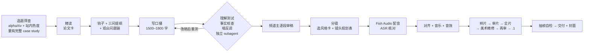
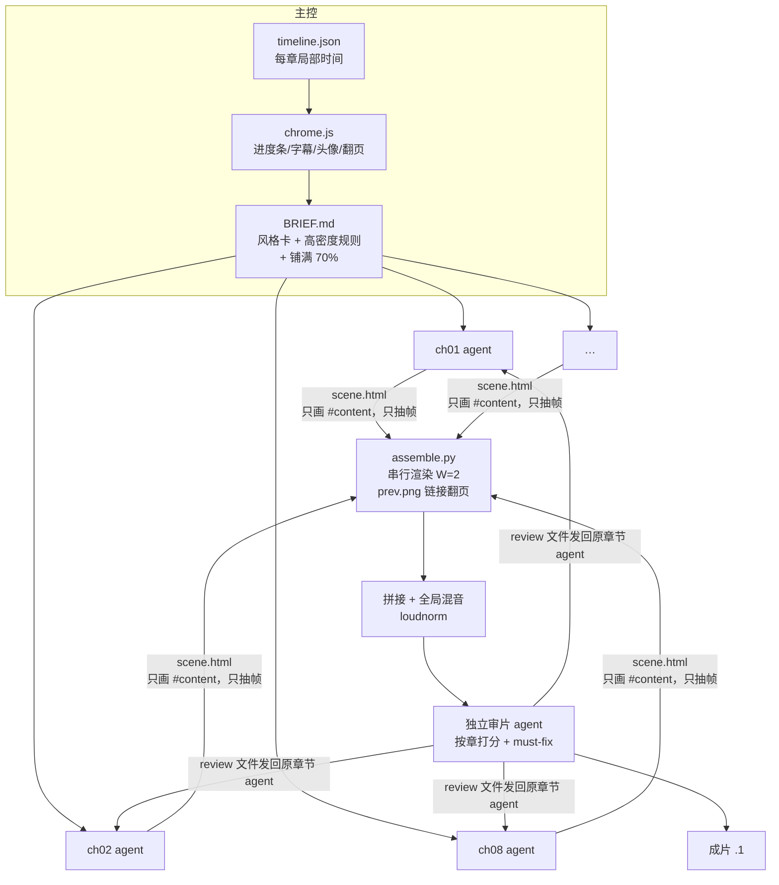

# paper-explainer-video

**arXiv 论文 → 5–6 分钟横屏中文解读视频**的 Claude skill，附带整套渲染模板。

这是小红书「刘铁柱」Agent 论文解读系列的实际生产流程：先读透论文、写好能「只听一遍就懂」的口播，再用 HTML + Playwright 逐帧渲染出有运镜、有论文实体页特写、有进度条和头像、有背景音乐和音效的 1080p 成片。第 1 期讲的是 Google 的 Harness²（arXiv 2610.14224），仓库里所有示例都来自那一期。


## 流程总览



顺序不能反：**内容定稿之前不做风格和制作。**完整规则见 [SKILL.md](SKILL.md)，包括：

- 论文卡要写什么（层级表、论文自带例子、作者思路重建、攻击面）
- 钩子结构（戳痛点 → 最独特的点 → 数字 → 反转）和口播的硬规则（只给名字不算解释、不跳步、先具体后抽象……）
- 三种运镜手法：连续变形、钻进论文（实体纸）、大画布运镜
- 顶部章节进度条、右下角头像、安全区
- 背景音乐 / 音效用 numpy 合成（无版权素材），以及 loudnorm 参数
- 审片和美术精修怎么交给独立 subagent
- 常见坑（每一条都是实际返工换来的）

## 5 张风格卡

画面 = **骨架**（运镜、转场、安全区，全片固定）+ **风格卡**（外观）。换风格只换卡。

| 卡 | 风格 | 适合 |
|---|---|---|
| **④ 默认** | 报刊数据新闻（FT / Bloomberg / NYT Upshot） | 论文解读、硬数字、前后对比 |
| ② | 手绘白板（Excalidraw） | Agent 架构、系统设计 |
| ① | 数学动画（3Blue1Brown / Manim） | 公式、机制推导 |
| ⑤ | 暗色开发者（Fireship / Vercel） | 工程实操、开发工具 |
| ③ | 新粗野主义 | 热点快讯、短钩子 |

每张卡都有一份 13.6 秒的参考实现，详见 [docs/style-cards.md](docs/style-cards.md)。

## v4：多 agent 按章并行

全片按章交给 8–9 个制作 agent 同时做。主控只负责公用件、统一渲染和拼接，审片 agent 独立打分并派回返工。



关键约定：

- 固定元素（进度条、字幕、头像、翻页进场）只在 `chrome.js` 里做一次，章节 agent 只画 `<div id="content">`，这样拼起来不会出现几套 UI
- 每章 t=0 就是完整版面，最后 0.5s 落定不动。下一章的翻页底图用上一章 `?nochrome=1` 渲出的最后一帧
- 超长章（>90s）拆给两个 agent，用一次甩镜交接
- 2 核机器上，agent 每轮只抽 ≤10 帧看效果，整段渲染由主控串行做


## 仓库结构

```
SKILL.md                      skill 本体（frontmatter + 中文全文）
templates/
  v3-single-agent/            Harness² v3.1 单 agent 代码（风格卡 A）——待补，见目录内 README
  v4-multi-agent/             多 agent 并行：chrome.js BRIEF.md build.py fixsubs.py assemble.py audio.py render.py sheet.py
  motion-prototypes/          转场原型 clipA/B/D、进度条组件 progress-bar.html + render_bar.py、音频原型
  style-cards/                5 张风格卡的 13.6s 参考实现 + 卡 ④ 正片级样片 A/B + 说明
  cover/                      封面模板 paper-cover-v2.html
docs/
  style-cards.md              风格卡说明
```

`b1_hook_paper_example.js`、`b4_big_canvas_example.js`、`h2_s4_*.html`、`clip*.html`、`BRIEF.md`、`build.py` 里的章节表等都写死了 **Harness² 那一期的内容**（口播、数字、论文图坐标），保留下来当示例，做新一期时照着结构改。

## 环境依赖

| 依赖 | 用途 |
|---|---|
| Python 3.10+、`playwright`（Python 包）+ Chromium | 逐帧渲染 `scene.html`（模板默认找 `/opt/pw-browsers`，也可以用 `playwright install chromium`） |
| ffmpeg（含 libx264、AAC、loudnorm、ebur128） | 编码、混音、响度测量 |
| numpy、Pillow | 合成音乐 / 音效、能量包络切句、联系表 |
| poppler-utils（`pdftoppm`、`pdftotext`） | 渲染论文页（300 / 720dpi），用词坐标量荧光笔框 |
| 字体：Noto Serif / Sans CJK SC、Inter、Latin Modern；按卡另需霞鹜文楷、JetBrains Mono、Caveat、Archivo Black、Space Grotesk | 画面 |
| 可选：sherpa-onnx + SenseVoice 模型（约 160MB） | 离线 ASR，核对 TTS 有没有读错、拿句级时间 |
| 可选：Fish Audio 账号 + 浏览器自动化 | 配音 |

## 怎么用

1. **装 skill**：把 `SKILL.md` 放进 Claude 的 skills 目录（例如 `~/.claude/skills/paper-explainer-video/SKILL.md`），或在 Claude.ai 里作为自定义 skill 上传。之后对 Claude 说「把这篇 arXiv 论文做成解读视频：<链接>」就会触发。
2. **模板落盘**：渲染和审片 subagent 通常读不到你的项目文档。开工前把要用的模板复制到本期工作目录，例如：
   ```bash
   WORK=~/videos/2026-xx-<topic>
   mkdir -p $WORK/kit
   cp templates/v4-multi-agent/* $WORK/kit/
   cp templates/style-cards/s4_editorial.html $WORK/kit/ref/   # 用哪张卡就拷哪张当质量标杆
   ```
   然后在给 subagent 的提示里写磁盘路径。
3. **换成你自己的素材**：头像序列（`<your-avatar-dir>`，RGBA PNG 循环帧）、片尾署名、封面上的系列名和期号、配音声线。
4. 文中的「频道主」就是你自己：审口播、看镜头规划表、听音量这几步需要人来确认。

## 作者

**刘铁柱** · 小红书「刘铁柱」 · X: Ning Chai

skill 和模板是作者和 Claude 一起迭代出来的，每条规则后面的日期注释说明了这条规则是什么时候、因为什么定下来的。

## License

[MIT](LICENSE)。仓库里不包含论文 PDF、论文整页渲染图、作者头像素材和人声音频。示例截图里出现的论文局部特写和头像只用于展示成片效果。

---

## English

**paper-explainer-video** is a Claude skill that turns an arXiv paper into a 5–6 minute, 1920×1080 Chinese explainer video. It is the production pipeline behind the Xiaohongshu channel 刘铁柱 (Liu Tiezhu).

The pipeline starts with content. Claude does a close reading and writes a "paper card", then a hook and a script built around the paper's own worked example. Independent subagents run a listen-once comprehension test, a fact check and a devil's-advocate review. Production comes after that: storyboarding with switchable style cards (FT-style editorial is the default), Fish Audio voice-over, synthesized music bed and SFX, and deterministic HTML scenes rendered frame by frame with Playwright and ffmpeg. Review and art-polish passes are handed to separate subagents. The v4 template splits the video by chapter across parallel agents that share one `chrome.js` for the progress bar, subtitles and avatar.

The repo contains `SKILL.md` (in Chinese) and the templates. Example files are hard-wired to episode 1 (Harness², arXiv 2610.14224). Paper PDFs, avatar footage and voice audio are not included. Licensed under MIT. Author: 刘铁柱 (Xiaohongshu), X: Ning Chai.
